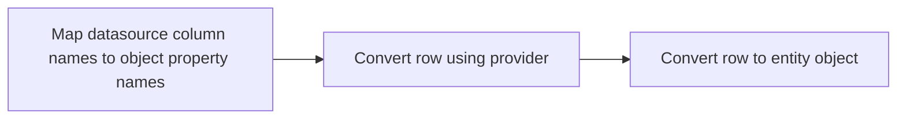

# The Mapping and Converting Pipelines

We will describe the primary mapping and converting pipelines used in Datasource below. These include:

- [The ReadonlyRepository read mapper and converting pipeline](#the-readonlyrepository-read-mapper-and-converting-pipeline)
- The statement mapping and converting pipeline (TODO)
- The SelectedIdMapping pipeline (TODO)

Words are great to describe these steps, but showing an example is worth more than a thousand words.

## The ReadonlyRepository read mapper and converting pipeline

This is the primary pipeline that maps and converts datasource rows to the entities used in the domain layer. We stop short of [object enrichment](../sections/enrichment.md) and leave that for another discussion.



### Map datasource column names to object property names

The reader returns raw rows (key/value pairs) which are renamed to the object property names using the mapper.

### Convert row using provider

{{RowConverter|rowConverter|row_converter}} converts the renamed row from provider cell types to object cell types. The keys stay the same. A SQLite bool stored as `1` or `0` becomes `true` or `false`. Uuid and datetime text become guid and datetime values where the dialect supports them.

Since the datasource type often can be mapped to multiple object types (string for example) the column type from the entity object must also be passed in.

### Convert row to entity object

{{ObjectConverter|objectConverter|object_converter}} assigns that row onto the entity. See [Metadata Row Type Converter](../sections/metadata-row-type-converter.md). You can also assign each property by hand.

::: prose
### csharp
The result is a `User`.
### typescript
The result is a `User` instance.
### rust
The result stays a `Row` and keeps the schema columns.
:::

### Example

One walkthrough: seed users, read the raw rows, rename columns, convert cell types, then build entities with {{MetaDataRowTypeConverter|MetaDataRowTypeConverter|MetaDataRowTypeConverter}} or a manual map.

::: example
```csharp csharp/Providers/Sqlite.Tests/ReadPipelineIntegrationTests.cs#User
```
```csharp csharp/Providers/Sqlite.Tests/ReadPipelineIntegrationTests.cs#MapsAndConvertsUsersThroughTheReadPipeline
```
```rust rust/providers/sqlite/tests/read_pipeline.rs#maps_and_converts_users_through_the_read_pipeline
```
```typescript typescript/providers/sqlite/tests/read-pipeline.integration.test.ts#User
```
```typescript typescript/providers/sqlite/tests/read-pipeline.integration.test.ts#maps-and-converts-users-through-the-read-pipeline
```

```output [Unmapped]
[
  { id: 1, uuid: '11111111-1111-1111-1111-111111111111', name: 'ada', is_enabled: 1, created: '2001-01-01T00:00:00.000Z' },
  { id: 2, uuid: '22222222-2222-2222-2222-222222222222', name: 'grace', is_enabled: 1, created: '2002-02-02T00:00:00.000Z' },
  { id: 3, uuid: '33333333-3333-3333-3333-333333333333', name: 'lin', is_enabled: 0, created: '2003-03-03T00:00:00.000Z' }
]
```

```output [Column mapped]
[
  { Id: 1, Uuid: '11111111-1111-1111-1111-111111111111', Username: 'ada', IsEnabled: 1, Created: '2001-01-01T00:00:00.000Z' },
  { Id: 2, Uuid: '22222222-2222-2222-2222-222222222222', Username: 'grace', IsEnabled: 1, Created: '2002-02-02T00:00:00.000Z' },
  { Id: 3, Uuid: '33333333-3333-3333-3333-333333333333', Username: 'lin', IsEnabled: 0, Created: '2003-03-03T00:00:00.000Z' }
]
```

```output:csharp [Type converted]
[
  { Id: 1, Uuid: Guid('11111111-1111-1111-1111-111111111111'), Username: 'ada', IsEnabled: true, Created: '2001-01-01T00:00:00.000Z' },
  { Id: 2, Uuid: Guid('22222222-2222-2222-2222-222222222222'), Username: 'grace', IsEnabled: true, Created: '2002-02-02T00:00:00.000Z' },
  { Id: 3, Uuid: Guid('33333333-3333-3333-3333-333333333333'), Username: 'lin', IsEnabled: false, Created: '2003-03-03T00:00:00.000Z' }
]
```

```output:rust [Type converted]
[
  { Id: 1, Uuid: Uuid('11111111-1111-1111-1111-111111111111'), Username: 'ada', IsEnabled: true, Created: '2001-01-01T00:00:00.000Z' },
  { Id: 2, Uuid: Uuid('22222222-2222-2222-2222-222222222222'), Username: 'grace', IsEnabled: true, Created: '2002-02-02T00:00:00.000Z' },
  { Id: 3, Uuid: Uuid('33333333-3333-3333-3333-333333333333'), Username: 'lin', IsEnabled: false, Created: '2003-03-03T00:00:00.000Z' }
]
```

```output:typescript [Type converted]
[
  { Id: 1, Uuid: '11111111-1111-1111-1111-111111111111', Username: 'ada', IsEnabled: true, Created: '2001-01-01T00:00:00.000Z' },
  { Id: 2, Uuid: '22222222-2222-2222-2222-222222222222', Username: 'grace', IsEnabled: true, Created: '2002-02-02T00:00:00.000Z' },
  { Id: 3, Uuid: '33333333-3333-3333-3333-333333333333', Username: 'lin', IsEnabled: false, Created: '2003-03-03T00:00:00.000Z' }
]
```

```output:csharp [Entities]
[
  { Id: 1, Uuid: Guid('11111111-1111-1111-1111-111111111111'), Username: 'ada', IsEnabled: true, Created: '2001-01-01T00:00:00.000Z' },
  { Id: 2, Uuid: Guid('22222222-2222-2222-2222-222222222222'), Username: 'grace', IsEnabled: true, Created: '2002-02-02T00:00:00.000Z' },
  { Id: 3, Uuid: Guid('33333333-3333-3333-3333-333333333333'), Username: 'lin', IsEnabled: false, Created: '2003-03-03T00:00:00.000Z' }
]
```

```output:typescript [Entities]
[
  { Id: 1, Uuid: '11111111-1111-1111-1111-111111111111', Username: 'ada', IsEnabled: true, Created: '2001-01-01T00:00:00.000Z' },
  { Id: 2, Uuid: '22222222-2222-2222-2222-222222222222', Username: 'grace', IsEnabled: true, Created: '2002-02-02T00:00:00.000Z' },
  { Id: 3, Uuid: '33333333-3333-3333-3333-333333333333', Username: 'lin', IsEnabled: false, Created: '2003-03-03T00:00:00.000Z' }
]
```

```output:rust [Entities]
[
  { Id: 1, Uuid: Uuid('11111111-1111-1111-1111-111111111111'), Username: 'ada', IsEnabled: true, Created: '2001-01-01T00:00:00.000Z' },
  { Id: 2, Uuid: Uuid('22222222-2222-2222-2222-222222222222'), Username: 'grace', IsEnabled: true, Created: '2002-02-02T00:00:00.000Z' },
  { Id: 3, Uuid: Uuid('33333333-3333-3333-3333-333333333333'), Username: 'lin', IsEnabled: false, Created: '2003-03-03T00:00:00.000Z' }
]
```

```output:csharp [Manual entities]
[
  { Id: 1, Uuid: Guid('11111111-1111-1111-1111-111111111111'), Username: 'ada', IsEnabled: true, Created: '2001-01-01T00:00:00.000Z' },
  { Id: 2, Uuid: Guid('22222222-2222-2222-2222-222222222222'), Username: 'grace', IsEnabled: true, Created: '2002-02-02T00:00:00.000Z' },
  { Id: 3, Uuid: Guid('33333333-3333-3333-3333-333333333333'), Username: 'lin', IsEnabled: false, Created: '2003-03-03T00:00:00.000Z' }
]
```

```output:typescript [Manual entities]
[
  { Id: 1, Uuid: '11111111-1111-1111-1111-111111111111', Username: 'ada', IsEnabled: true, Created: '2001-01-01T00:00:00.000Z' },
  { Id: 2, Uuid: '22222222-2222-2222-2222-222222222222', Username: 'grace', IsEnabled: true, Created: '2002-02-02T00:00:00.000Z' },
  { Id: 3, Uuid: '33333333-3333-3333-3333-333333333333', Username: 'lin', IsEnabled: false, Created: '2003-03-03T00:00:00.000Z' }
]
```
:::
